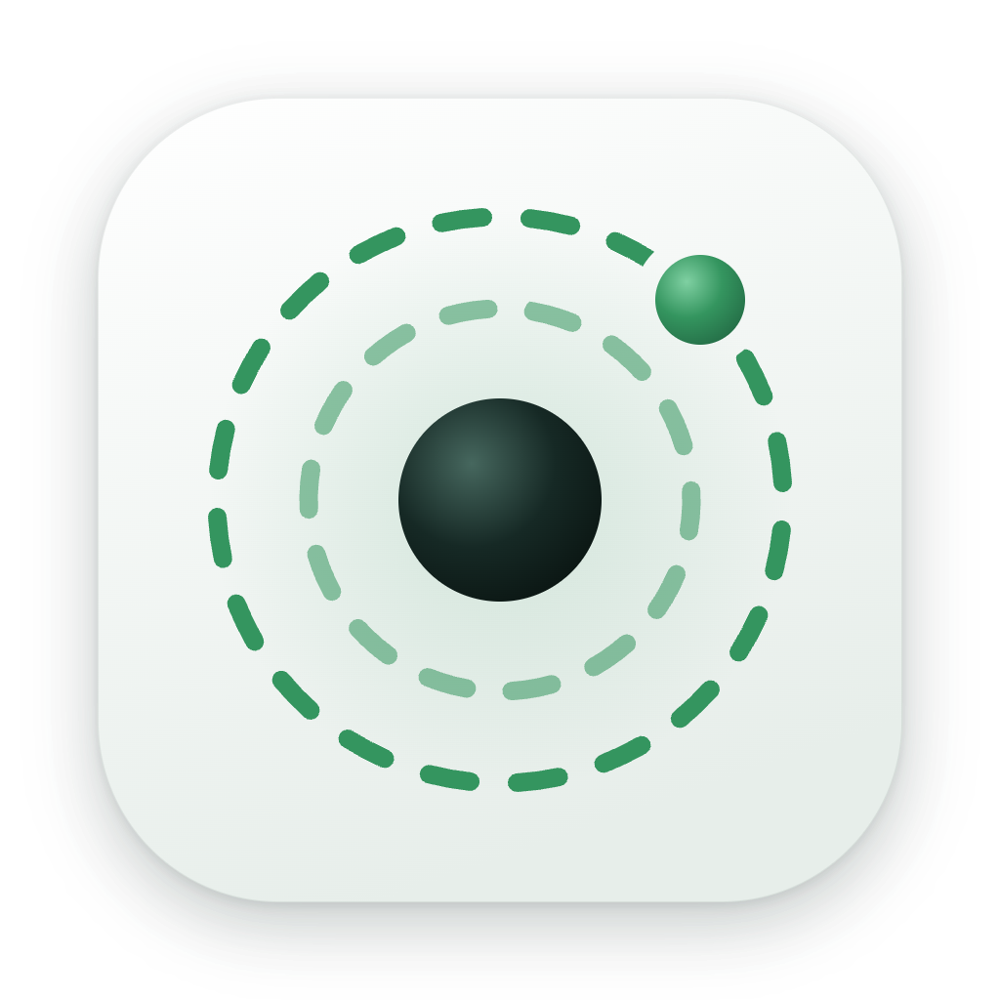
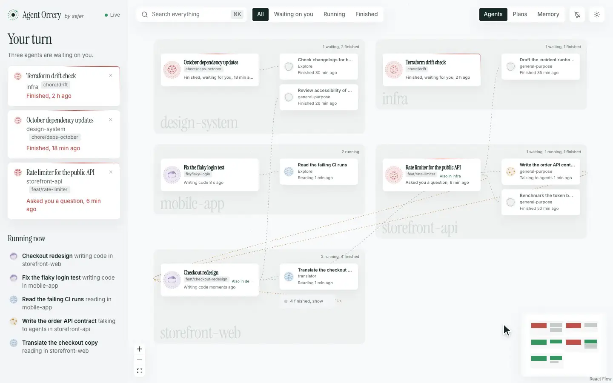
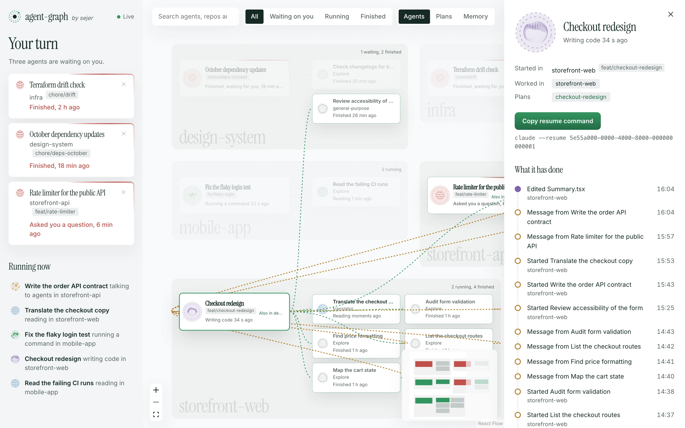
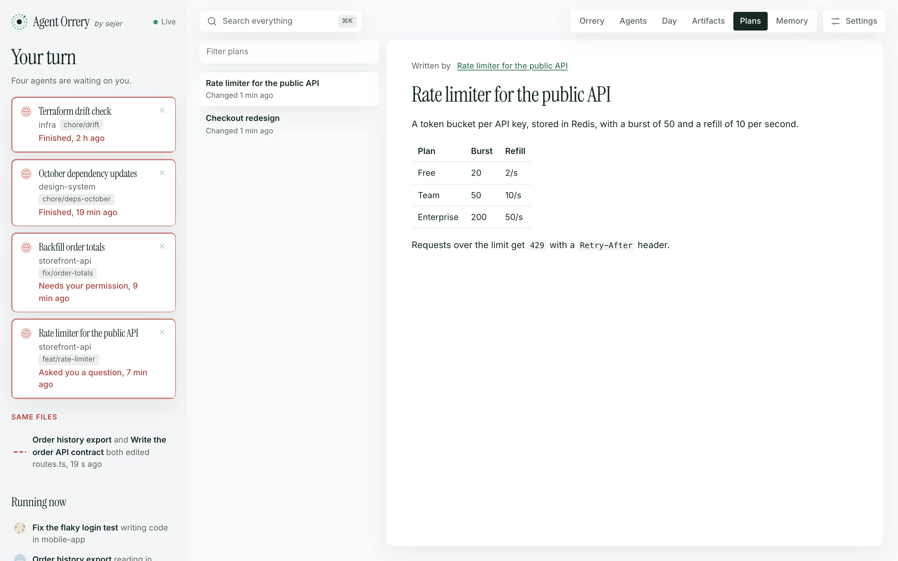
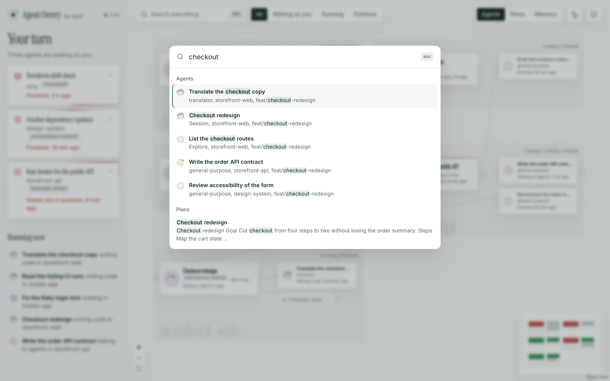
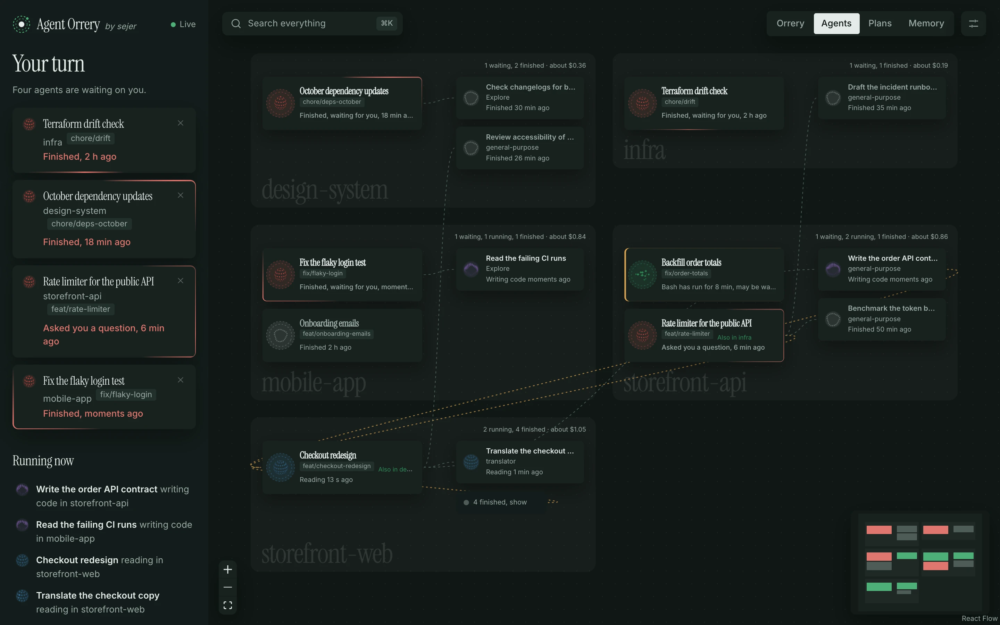

<p align="center">
  
</p>

<h1 align="center">Agent Orrery</h1>

<p align="center">
  <strong>A live map of your Claude Code agents, and what's waiting on you.</strong><br>
  See every session and subagent, the repo each one is working in, who started whom, and which sessions need your reply.
</p>

<p align="center">
  <a href="https://github.com/Luis-Sejer/agent-orrery/actions/workflows/ci.yml"></a>
  <a href="LICENSE"></a>
  
  
  
</p>

<p align="center">
  <picture>
    <source media="(prefers-color-scheme: dark)" srcset="docs/assets/hero-dark.webp">
    
  </picture>
  <br>
  <sub><a href="https://orrery.luissejer.dk/"><strong>orrery.luissejer.dk</strong></a> · <a href="docs/assets/agent-orrery-launch.mp4">Watch the launch video</a> (25 s, with sound)</sub>
  <br>
  <sub>Made-up sessions. Run <code>pnpm demo</code> to explore them yourself.</sub>
</p>

## Why

Run a few Claude Code sessions with subagents and it gets hard to keep track. Which one asked you a question an hour ago? Which agent is editing the web app for a session you started in the API? Did that subagent finish?

Agent Orrery answers that at a glance. It reads the transcripts Claude Code already writes, so there's nothing to set up in Claude: no hooks, no plugins, no MCP servers.

## Features

- **Your turn.** Every session that finished or asked you something, oldest first, with how long it has waited. The tab title shows the count. Dismiss one until it does something new.
- **Rooms per repository.** Each agent sits in the repo its work touches, not the folder its session started in. A session started in the API whose subagents edit the web app reaches across into the web app's room.
- **Live state.** Each agent's orb shows what it's doing now: reading, writing code, running a command, talking to other agents, or waiting on you. Messages between agents travel along the lines as they're sent.
- **Focus.** Click an agent to light up its parent, its subagents and everyone it messaged, and dim the rest. A drawer shows what it has done, step by step, and a command to resume the session.
- **Search everything.** Press <kbd>⌘</kbd> <kbd>K</kbd> to find agents by name, repo or branch, and plans and memory notes by what they say.
- **Notifications.** Turn them on and your browser tells you when a session starts waiting on you while you're in another tab.
- **Cost.** An estimate of what each agent, session and room has cost, worked out in your browser from the token counts and Anthropic's published prices. Models it has no price for show tokens only.
- **Quiet agents.** An agent that is running but has been silent for five minutes is flagged, and if a tool call is still open it says which one: that is how a permission prompt looks from outside, so it may be waiting for your approval.
- **Replay.** Press Replay and drag back through the last hours (the same window as `AGENT_ORRERY_WINDOW_HOURS`) to see who was running, waiting and finished at any moment. Notifications stay off while you replay.
- **Plans and memory.** Read the plans and memory notes Claude has saved, by project.
- **Light and dark.** Follows your system, or pick one.
- **Quiet by design.** It only reads files, never writes them, and nothing leaves your machine.

### What the orbs mean

| Orb | The agent is… |
|---|---|
| Green | running a command, or thinking |
| Blue | reading or searching code, including `cat` and `grep` in the shell |
| Violet | writing code, including edits made in the shell |
| Amber | starting a subagent or messaging another agent |
| Red | waiting on you |
| Grey | finished |

<table>
  <tr>
    <td width="50%"></td>
    <td width="50%"></td>
  </tr>
  <tr>
    <td><sub>Click an agent to see everything connected to it.</sub></td>
    <td><sub>Plans, linked to the sessions that wrote them.</sub></td>
  </tr>
  <tr>
    <td width="50%"></td>
    <td width="50%"></td>
  </tr>
  <tr>
    <td><sub>Search agents, plans and memory with <kbd>⌘</kbd> <kbd>K</kbd>.</sub></td>
    <td><sub>Dark, when your system is.</sub></td>
  </tr>
</table>

## Get started

### Let your agent install it

Ask Claude Code, or any coding agent:

> Install Agent Orrery for me: clone https://github.com/Luis-Sejer/agent-orrery and follow its INSTALL.md.

[`INSTALL.md`](INSTALL.md) walks the agent through checking Docker, writing settings for your machine, starting the container and checking it works.

### With Docker

```bash
git clone https://github.com/Luis-Sejer/agent-orrery.git
cd agent-orrery
printf 'AGENT_ORRERY_UID=%s\nAGENT_ORRERY_GID=%s\n' "$(id -u)" "$(id -g)" > .env
docker compose up -d --build
```

Open http://127.0.0.1:4777. The container comes back after a crash and whenever Docker starts. To have it after a reboot, turn on **Start Docker Desktop when you sign in** in Docker Desktop's settings.

### From source

Needs Node 24 and pnpm (`corepack enable`).

```bash
pnpm install
pnpm build
pnpm start        # http://127.0.0.1:4777
```

### Just looking

```bash
pnpm install
pnpm demo         # made-up sessions on http://127.0.0.1:4780
```

## Settings

Set these in your shell, or in a `.env` file next to `compose.yaml`.

| Variable | Default | What it does |
|---|---|---|
| `AGENT_ORRERY_CODE_DIR` | `~/Documents/GitHub` | Folder holding your repositories, shared read-only with the container so it can tell which repo an agent works in (Docker only) |
| `AGENT_ORRERY_UID` / `AGENT_ORRERY_GID` | `501` / `20` | Your user and group id; Claude Code's files are readable only by you (Docker only) |
| `AGENT_ORRERY_PORT` | `4777` | Port on this machine |
| `AGENT_ORRERY_WINDOW_HOURS` | `6` | How far back to show sessions and agents |
| `AGENT_ORRERY_WAITING_HOURS` | `24` | How long a session waiting on you stays listed |
| `AGENT_ORRERY_CLAUDE_DIR` | `~/.claude` | Where Claude Code keeps its files (from source only) |

## How it works

Claude Code saves every session to `~/.claude/projects/<project>/<session>.jsonl`, and each subagent to a file beside it. Agent Orrery reads new lines as soon as the files change, with a check every few seconds in case a change notification goes missing, and builds a graph:

- **Sessions and subagents** come from those files and their metadata.
- **Rooms** come from the file paths each agent's tools touch. Agent Orrery walks up from each path to the nearest git repository, and counts a worktree as its main repository.
- **Orb colours** come from the last tool each agent used. Shell commands count by what they do: `cat` and `grep` read, `sed -i` and redirects write. Only the colour is kept, never the command.
- **Waiting on you** means the session's last reply ended its turn, or it asked a question you haven't answered.
- **Messages** come from agents' `SendMessage` calls and the replies they receive.
- **Cost** comes from the token counts on each reply, counted once per message and kept per model. Prices live in one table, `web/src/pricing.ts`, so the figure is an estimate.
- **Quiet** means a tool call has started and no result has come back, and nothing else has happened for five minutes.
- **Replay** uses a short history of state changes the server keeps for each agent (a few hundred entries, in memory only).

The page is React with [React Flow](https://reactflow.dev) and [Thinking Orbs](https://libraries.dev/orbs). The server is plain Node with no dependencies.

## Privacy and security

Your transcripts hold your code, your prompts and sometimes secrets, so Agent Orrery is built to keep them in:

- **The graph holds no content.** Only titles, repo and branch names, agent types, tool names, file names, token counts, model names and times reach the page. Never messages, commands or tool output.
- **It only listens on this machine.** The server binds to `127.0.0.1`, and Docker publishes it there only.
- **Other websites can't read it.** Requests for another hostname are refused, which blocks DNS rebinding. So are data requests from other sites.
- **Read-only.** It never writes to your files, and the server accepts only `GET` requests. Plans and notes are opened by name from the server's own folder listing, never by a path from the request.
- **No scripts from content.** Plans and notes render as Markdown without raw HTML or images, under a strict Content Security Policy.
- **A small supply chain.** The server has no dependencies. Front-end packages are pinned and only installed once they're a week old, and the Docker images are pinned by digest. The container runs as you, with a read-only filesystem and no Linux capabilities.

Found a problem? See [SECURITY.md](SECURITY.md).

## FAQ

**Does it work with several machines?** No. It reads the Claude Code files on the machine it runs on.

**Do notifications work when the tab is closed?** No. They come from the dashboard tab, so keep it open, in the background, or pinned.

**Does it slow Claude Code down?** No. It reads files Claude Code writes anyway, and adds no hooks.

**Why is an agent in the wrong room?** The room is the repository its tools touched most. An agent that only ran shell commands, without paths, stays with its session. In Docker, repositories outside `AGENT_ORRERY_CODE_DIR` can't be seen.

**Does it work on Linux?** Yes. Set `AGENT_ORRERY_UID`, `AGENT_ORRERY_GID` and `AGENT_ORRERY_CODE_DIR` to match your machine.

## Contributing

Bug reports, ideas and pull requests are welcome. See [CONTRIBUTING.md](CONTRIBUTING.md), and [AGENTS.md](AGENTS.md) if an agent is doing the work.

## Licence

[MIT](LICENSE). Not affiliated with Anthropic. Logos, icons and the press kit are in [`docs/assets/brand`](docs/assets/brand/README.md).
