<p align="center">
  
</p>

<h1 align="center">Agent Orrery</h1>

<p align="center">
  <strong>A live map of your Claude Code agents, and what's waiting on you.</strong><br>
  See every session and subagent, the repo each one is working in, who started whom, and which sessions need your reply.
</p>

<p align="center">
  <a href="https://github.com/Luis-Sejer/agent-orrery/actions/workflows/ci.yml"></a>
  <a href="LICENSE"></a>
  
  
  
</p>

<p align="center">
  <picture>
    <source media="(prefers-color-scheme: dark)" srcset="docs/assets/hero-dark.webp">
    
  </picture>
  <br>
  <sub><a href="https://orrery.luissejer.dk/"><strong>orrery.luissejer.dk</strong></a> · <a href="docs/assets/agent-orrery-launch.mp4">Watch the launch video</a> (25 s, with sound)</sub>
  <br>
  <sub>Made-up sessions. Run <code>pnpm demo</code> to explore them yourself.</sub>
</p>

## Why

Run a few Claude Code sessions with subagents and it gets hard to keep track. Which one asked you a question an hour ago? Which agent is editing the web app for a session you started in the API? Did that subagent finish?

Agent Orrery answers that at a glance. It reads the transcripts Claude Code already writes, so there's nothing to set up in Claude: no hooks, no plugins, no MCP servers.

## Features

- **The orrery.** The page opens on your agents in rings around you: whatever waits on you sits closest, running agents next, finished ones on the outside, with a sector for each repository. Working across many repositories? Arrange it by repository instead: each one gets a ring of its own, and the ones that need you move inwards. Or as a galaxy: each repository is a small solar system with its own rings, and the systems that need you sit closest. The rings turn slowly, inner ones faster, and steady themselves while you point at an agent. Agents, one tab over, lays the same agents out as a grid of rooms, or as a tree of who started whom.
- **Your turn.** Every session that finished, asked you something or is waiting on a permission prompt, oldest first, with how long it has waited. It comes from Claude Code's own status for each running session, so a closed terminal drops off at once. The tab title shows the count. Dismiss one until it does something new.
- **Same files.** Two agents editing the same file within minutes of each other get a red line between them, and a warning in Your turn, before they undo each other's work.
- **Day.** Today's sessions on one clock: when each worked, when it sat waiting on you, and how long something was waiting on you in total.
- **Plan usage.** Your plan's session and weekly usage, the same numbers as `/usage`, live under Your turn, round T.Y.C.H.O.'s core and in the menu bar, amber near the limit and red at it, with a forecast: "At this pace, you'll reach the limit around 17:40" It takes [one line in your status line](#plan-usage).
- **Artifacts.** Every page your agents published on claude.ai, from all their sessions, newest first, with a filter and ⌘K search. Agents that published something carry a small mark, and their drawer lists what they made. Each one opens on claude.ai.
- **Rooms per repository.** Each agent sits in the repo its work touches, not the folder its session started in. A session started in the API whose subagents edit the web app reaches across into the web app's room. In a monorepo, each busy package gets a room of its own.
- **Focus.** Click an agent, or Tab to it and press Enter, to light up its parent, its subagents and everyone it messaged, and dim the rest. A drawer shows what it has done, step by step, and a command to resume the session.
- **Cost.** An estimate of what each agent, session and room has cost, worked out in your browser from the token counts and Anthropic's published prices. Models it has no price for show tokens only.
- **Replay.** Turn on Replay in the settings and drag back through the last hours (the same window as `AGENT_ORRERY_WINDOW_HOURS`) to see who was running, waiting and finished at any moment. Notifications stay off while you replay.
- **Light, dark and T.Y.C.H.O.** Follows your system, or pick one. T.Y.C.H.O. (Tracks Your Claude Helpers' Orbits) is a holographic HUD in amber on black.
- **A clean dashboard.** Search and the views sit on top; filters, the arrangement, themes, replay, notifications, voice, Hide finished, whether worktrees get rooms of their own and Pause motion are in one settings menu. Hide finished takes finished agents off the canvas, with every room or solar system that has nothing going on. Clean view hides the side panel, minimap and zoom too, for a screen you glance at, and keeps a small list of who's waiting on you in a corner. The page remembers all of it, and `.env` can set what every browser starts with.
- **Local, and it doesn't touch your files.** It only reads Claude Code's files and your code, and nothing leaves your machine. The one thing it saves is its own settings, in its own folder, so every browser opens the same way.

<details>
<summary><strong>And more:</strong> live state, search everything, notifications, menu bar, quiet agents, voice, plans and memory</summary>

- **Live state.** Each agent's orb shows what it's doing now: reading, writing code, running a command, talking to other agents, or waiting on you. Messages between agents travel along the lines as they're sent, and every tool call a subagent makes sends a small packet to the session that started it.
- **Search everything.** Press <kbd>⌘</kbd> <kbd>K</kbd> (<kbd>Ctrl</kbd> <kbd>K</kbd> elsewhere) to find agents by name, repo or branch, and plans and memory notes by what they say.
- **Notifications.** Turn them on in the settings and your browser tells you when a session starts waiting on you while you're in another tab.
- **Menu bar.** On a Mac, a small [menu bar app](#menu-bar-companion) shows how many sessions are waiting on you, and opens the one you pick.
- **Quiet agents.** An agent that is running but has been silent for five minutes is flagged, and if a tool call is still open it says which one: that is how a permission prompt looks from outside, so it may be waiting for your approval.
- **Voice.** Turn on Voice in the settings and the page says out loud which session is waiting on you, using the best British voice on your machine. On a Mac, add a better one in System Settings → Accessibility → Spoken Content → System voice → Manage voices (a Premium British voice sounds most natural).
- **Plans and memory.** Read the plans and memory notes Claude has saved, by project.

</details>

### What the orbs mean

| Orb | The agent is… |
|---|---|
| Green | running a command, or thinking |
| Blue | reading or searching code, including `cat` and `grep` in the shell |
| Violet | writing code, including edits made in the shell |
| Amber | starting a subagent or messaging another agent |
| Red | waiting on you |
| Grey | finished |

<table>
  <tr>
    <td width="50%">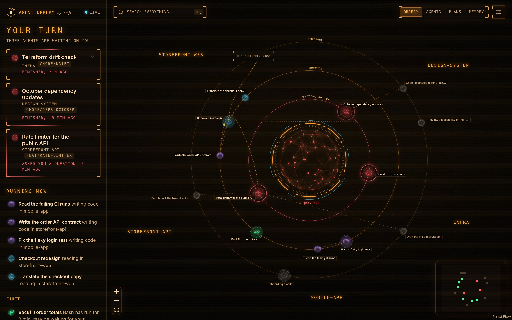</td>
    <td width="50%"></td>
  </tr>
  <tr>
    <td><sub>T.Y.C.H.O., the HUD theme.</sub></td>
    <td><sub>Agents, the grid of rooms. Click an agent to see everything connected to it, and what it cost.</sub></td>
  </tr>
  <tr>
    <td width="50%">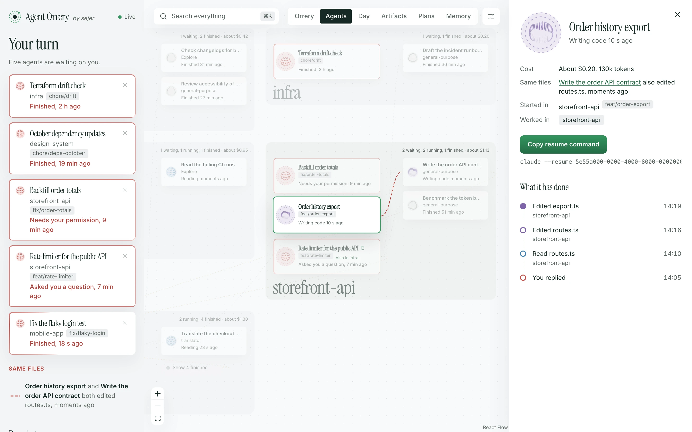</td>
    <td width="50%">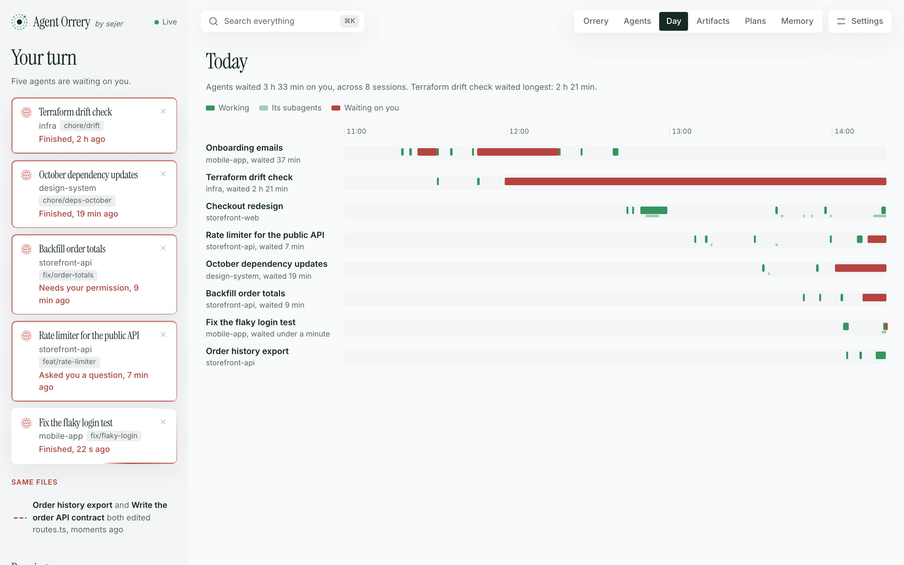</td>
  </tr>
  <tr>
    <td><sub>Same files: two agents in one file get a red line before they undo each other's work.</sub></td>
    <td><sub>Your day: when each session worked and when it waited on you.</sub></td>
  </tr>
</table>

<details>
<summary><strong>More screenshots:</strong> artifacts, the tree, a monorepo, a galaxy, replay, search, arranged by repository, the settings, plans and the dark theme</summary>

<table>
  <tr>
    <td width="50%">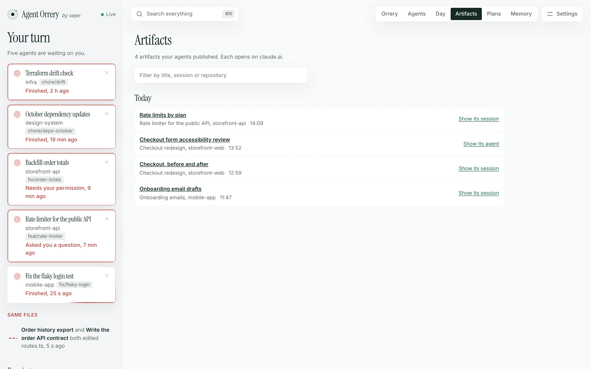</td>
    <td width="50%">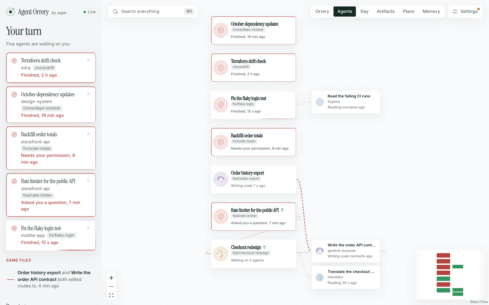</td>
  </tr>
  <tr>
    <td><sub>Every artifact your agents published, in one place.</sub></td>
    <td><sub>Agents as a tree of who started whom, with finished ones hidden.</sub></td>
  </tr>
</table>

<p>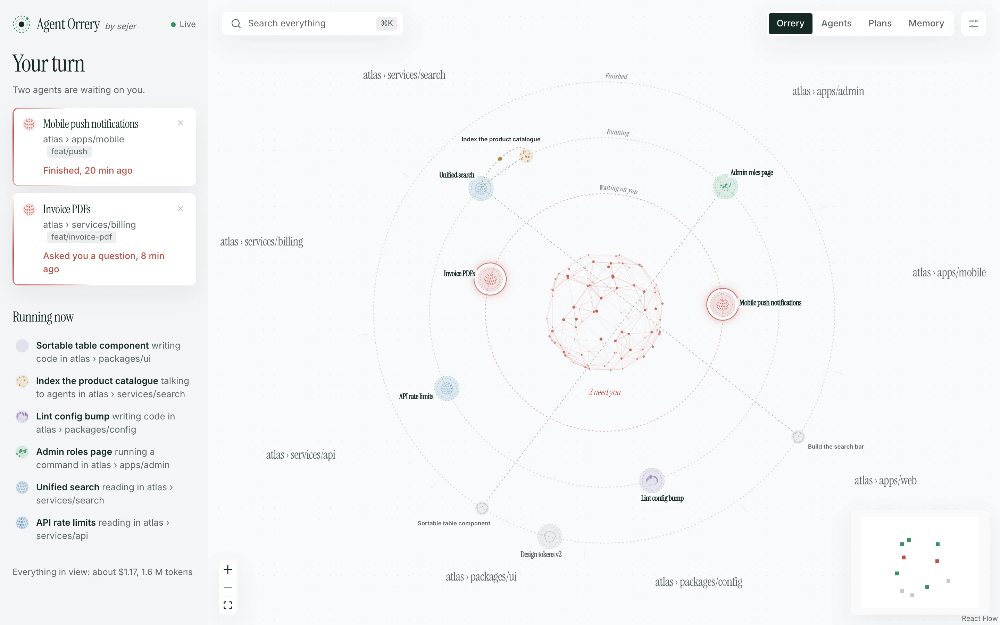</p>
<p><sub>A monorepo: every busy package gets a room of its own.</sub></p>

<p>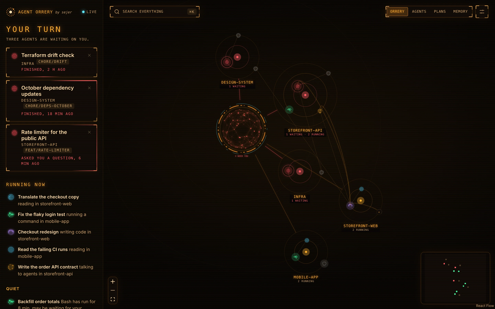</p>
<p><sub>A galaxy: a solar system per repository, the ones that need you closest.</sub></p>

<table>
  <tr>
    <td width="50%">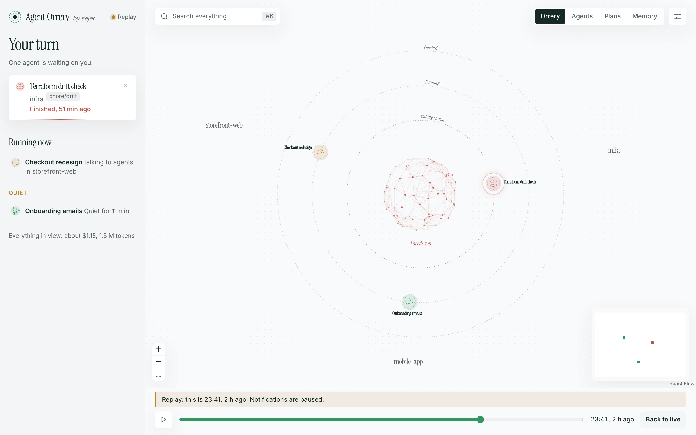</td>
    <td width="50%"></td>
  </tr>
  <tr>
    <td><sub>Replay the last hours.</sub></td>
    <td><sub>Search agents, artifacts, plans and memory with <kbd>⌘</kbd> <kbd>K</kbd>.</sub></td>
  </tr>
  <tr>
    <td width="50%">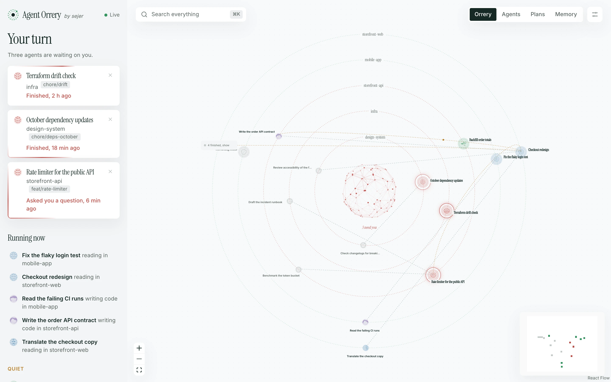</td>
    <td width="50%">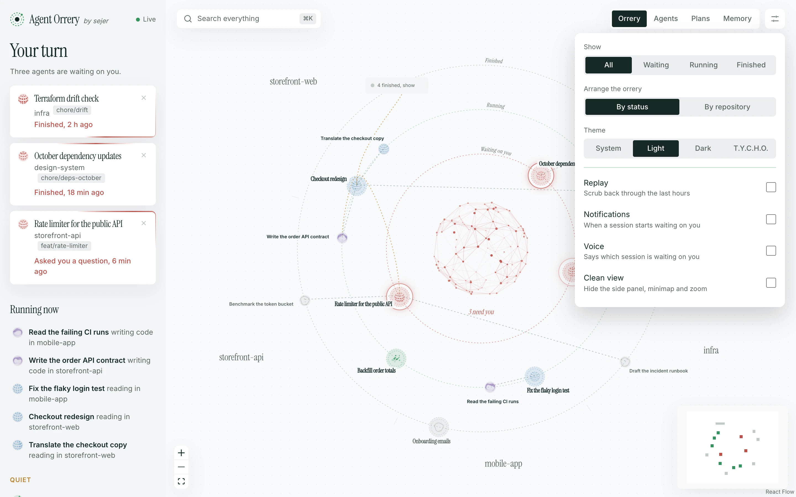</td>
  </tr>
  <tr>
    <td><sub>Or a ring per repository, the ones that need you innermost.</sub></td>
    <td><sub>Everything else lives in one settings menu.</sub></td>
  </tr>
  <tr>
    <td width="50%"></td>
    <td width="50%">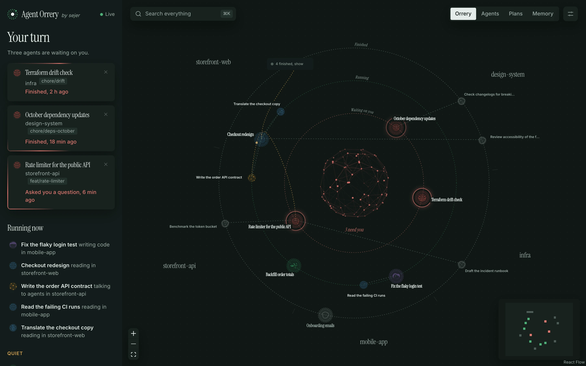</td>
  </tr>
  <tr>
    <td><sub>Plans, linked to the sessions that wrote them.</sub></td>
    <td><sub>Dark, when your system is.</sub></td>
  </tr>
</table>

</details>

## Get started

### Let your agent install it

Ask Claude Code, or any coding agent:

> Install Agent Orrery for me: clone https://github.com/Luis-Sejer/agent-orrery and follow its INSTALL.md.

[`INSTALL.md`](INSTALL.md) walks the agent through checking Docker, writing settings for your machine, starting the container and checking it works.

### With Docker

```bash
git clone https://github.com/Luis-Sejer/agent-orrery.git
cd agent-orrery
printf 'AGENT_ORRERY_UID=%s\nAGENT_ORRERY_GID=%s\n' "$(id -u)" "$(id -g)" > .env
docker compose up -d --build
```

Open http://127.0.0.1:4777. The container comes back after a crash and whenever Docker starts. To have it after a reboot, turn on **Start Docker Desktop when you sign in** in Docker Desktop's settings.

<details>
<summary><strong>From source</strong></summary>

Needs Node 24 and pnpm (`corepack enable`).

```bash
pnpm install
pnpm build
pnpm start        # http://127.0.0.1:4777
```

</details>

<details>
<summary><strong>Just looking: the demo, with made-up sessions</strong></summary>

```bash
pnpm install
pnpm demo         # made-up sessions on http://127.0.0.1:4780
```

</details>

## Menu bar companion

On a Mac, a small menu bar app shows how many sessions are waiting on you and opens the one you pick in the dashboard. Build it with `./menubar/build.sh`; see [`menubar/README.md`](menubar/README.md).

## Plan usage

Claude Code shows your plan's limits in `/usage`, but hands the numbers only to your status line. A small bridge in this repository, [`statusline/orrery-usage.sh`](statusline/orrery-usage.sh), writes them (the percentages and reset times, nothing else) to `~/.claude/orrery/usage.json`, and Orrery shows them live. It needs `jq`, and a plan with usage limits: with an API key there is nothing to show.

```bash
mkdir -p ~/.claude/orrery
cp statusline/orrery-usage.sh ~/.claude/orrery-usage.sh
```

Then connect it to your status line:

- **No status line yet?** Make it your status line: in `~/.claude/settings.json`, set `"statusLine": { "type": "command", "command": "bash ~/.claude/orrery-usage.sh" }`. It shows `5h 65% · 7d 11%`.
- **Have your own script?** Add one line right after it reads its input (`input=$(cat)`):
  ```bash
  printf '%s' "$input" | bash ~/.claude/orrery-usage.sh >/dev/null 2>&1
  ```

Restart Orrery (`docker compose up -d`) so Docker shares `~/.claude/orrery`. After your next message to Claude, the usage shows up. Or ask your agent: INSTALL.md's step 6 does all of this, asking you first.

The numbers are as fresh as the last status line Claude Code drew, every few seconds while you work. When everything has been idle for a while, the page says how old they are.

## Settings

Set these in your shell, or in a `.env` file next to `compose.yaml`.

<details>
<summary><strong>All settings:</strong> port, history window, folders, user</summary>

| Variable | Default | What it does |
|---|---|---|
| `AGENT_ORRERY_CODE_DIR` | `~/Documents/GitHub` | Folder holding your repositories, shared read-only with the container so it can tell which repo an agent works in (Docker only) |
| `AGENT_ORRERY_UID` / `AGENT_ORRERY_GID` | `501` / `20` | Your user and group id; Claude Code's files are readable only by you (Docker only) |
| `AGENT_ORRERY_PORT` | `4777` | Port on this machine |
| `AGENT_ORRERY_WINDOW_HOURS` | `6` | How far back to show sessions and agents; also in Settings → Advanced |
| `AGENT_ORRERY_WAITING_HOURS` | `24` | How long a session waiting on you stays listed; also in Settings → Advanced |
| `AGENT_ORRERY_CLAUDE_DIR` | `~/.claude` | Where Claude Code keeps its files (from source only) |
| `AGENT_ORRERY_DATA` | `./data` | Folder for its own settings and dismissed sessions, the only one it writes to (Docker only) |
| `AGENT_ORRERY_DATA_DIR` | `~/.config/agent-orrery` | The same, running from source |

Settings you change on the page are saved by the server (in `./data`, or `AGENT_ORRERY_DATA`), so every browser opens the same way. These give a fresh install its starting settings; Settings → "Copy these settings for .env" writes the lines for you.

| Variable | Values |
|---|---|
| `AGENT_ORRERY_VIEW` | `orrery`, `graph` (Agents), `day`, `artifacts`, `plans`, `memory` |
| `AGENT_ORRERY_ARRANGEMENT` | `status`, `room`, `galaxy` |
| `AGENT_ORRERY_THEME` | `system`, `light`, `dark`, `tycho` |
| `AGENT_ORRERY_AGENTS_LAYOUT` | `rooms`, `tree` |
| `AGENT_ORRERY_HIDE_FINISHED`, `AGENT_ORRERY_WORKTREE_ROOMS`, `AGENT_ORRERY_CLEAN_VIEW`, `AGENT_ORRERY_PAUSE_MOTION`, `AGENT_ORRERY_VOICE`, `AGENT_ORRERY_NOTIFICATIONS` | `on`, `off` |

</details>

## How it works

Claude Code saves every session to `~/.claude/projects/<project>/<session>.jsonl`, and each subagent to a file beside it. Agent Orrery reads new lines as soon as the files change, with a check every few seconds in case a change notification goes missing, and builds a graph:

- **Sessions and subagents** come from those files and their metadata.
- **Rooms** come from the file paths each agent's tools touch. Agent Orrery walks up from each path to the nearest git repository, and counts a worktree as its main repository.
- **Orb colours** come from the last tool each agent used. Shell commands count by what they do: `cat` and `grep` read, `sed -i` and redirects write. Only the colour is kept, never the command.
- **Waiting on you** comes from Claude Code itself where it can: each running session keeps a small status file (`~/.claude/sessions/<pid>.json`) saying whether it is busy, idle or waiting, and for what, such as a permission prompt. A session without one has ended. Where there are no status files, it means the session's last reply ended its turn, or it asked a question you haven't answered.
- **Same files** compares the paths agents edited in the last ten minutes. Only file names reach the page.
- **Plan usage** comes from `~/.claude/orrery/usage.json`, which the status line bridge writes. Orrery never asks Anthropic for it and never reads your login.
- **Artifacts** come from the agents' `Artifact` calls: the title they gave a page, and its claude.ai address from the reply. Nothing else in the reply is kept.
- **Messages** come from agents' `SendMessage` calls and the replies they receive.
- **Cost** comes from the token counts on each reply, counted once per message and kept per model. Prices live in one table, `web/src/pricing.ts`, so the figure is an estimate.
- **Quiet** means a tool call has started and no result has come back, and nothing else has happened for five minutes.
- **Replay** and **Day** use a short history of state changes the server keeps for each agent (a few hundred entries, in memory only).

The page is React with [React Flow](https://reactflow.dev) and [Thinking Orbs](https://libraries.dev/orbs). The server is plain Node with no dependencies.

## Privacy and security

Your transcripts hold your code, your prompts and sometimes secrets, so Agent Orrery is built to keep them in:

- **The graph holds no content.** Only titles, repo and branch names, agent types, tool names, file names, token counts, model names, times and the titles and addresses of published artifacts reach the page. Never messages, commands or tool output.
- **It only listens on this machine.** The server binds to `127.0.0.1`, and Docker publishes it there only.
- **Other websites can't read it.** Requests for another hostname are refused, which blocks DNS rebinding. So are data requests from other sites.
- **It never writes your files.** Claude Code's files and your code are mounted read-only. The only writes the server accepts are your settings and dismissed sessions, from its own page only, as JSON, checked against a fixed list, into its own data folder. Plans and notes are opened by name from the server's own folder listing, never by a path from the request.
- **No scripts from content.** Plans and notes render as Markdown without raw HTML or images, under a strict Content Security Policy.
- **A small supply chain.** The server has no dependencies. Front-end packages are pinned and only installed once they're a week old, and the Docker images are pinned by digest. The container runs as you, with a read-only filesystem apart from its data folder, and no Linux capabilities.

Found a problem? See [SECURITY.md](SECURITY.md).

## FAQ

<details>
<summary><strong>Does it work with several machines?</strong></summary>

No. It reads the Claude Code files on the machine it runs on.

</details>

<details>
<summary><strong>Do notifications work when the tab is closed?</strong></summary>

No. They come from the dashboard tab, so keep it open, in the background, or pinned.

</details>

<details>
<summary><strong>Does it slow Claude Code down?</strong></summary>

No. It reads files Claude Code writes anyway, and adds no hooks.

</details>

<details>
<summary><strong>How does it handle a monorepo?</strong></summary>

A repository is a monorepo when its root declares a workspace (`pnpm-workspace.yaml` with `packages`, `workspaces` in `package.json`, a Cargo workspace, `go.work`, Nx, Turborepo, Lerna or Rush), or has no project of its own and two or more packages below it. Each package then becomes an area, shown as a room such as `shop › apps/web`; files at the root stay with the repository, and dependency and build folders like `node_modules` never count. It only splits a repository while two or more of its areas are busy, so most of the time it looks like any other repository. To name the areas yourself, add an `.orrery.json` at the root: `{"areas": ["apps/*", "services/*", "infra"]}`, where `*` stands for one folder.

</details>

<details>
<summary><strong>Why is an agent in the wrong room?</strong></summary>

The room is the repository its tools touched most. An agent that only ran shell commands, without paths, stays with its session. In Docker, repositories outside `AGENT_ORRERY_CODE_DIR` can't be seen.

</details>

<details>
<summary><strong>How accurate is the cost?</strong></summary>

It's an estimate: the token counts in the transcripts, priced at Anthropic's published API rates, with fast mode and long prompts included. On a Claude subscription you're billed differently, so read it as what the same work would cost on the API.

</details>

<details>
<summary><strong>Does the voice send anything anywhere?</strong></summary>

No. It only uses voices installed on your machine, never a network voice, so session titles stay local.

</details>

<details>
<summary><strong>Does it work on Linux?</strong></summary>

Yes. Set `AGENT_ORRERY_UID`, `AGENT_ORRERY_GID` and `AGENT_ORRERY_CODE_DIR` to match your machine.

</details>

## Contributing

Bug reports, ideas and pull requests are welcome. See [CONTRIBUTING.md](CONTRIBUTING.md), and [AGENTS.md](AGENTS.md) if an agent is doing the work.

## Licence

[MIT](LICENSE). Not affiliated with Anthropic. Logos, icons and the press kit are in [`docs/assets/brand`](docs/assets/brand/README.md).
