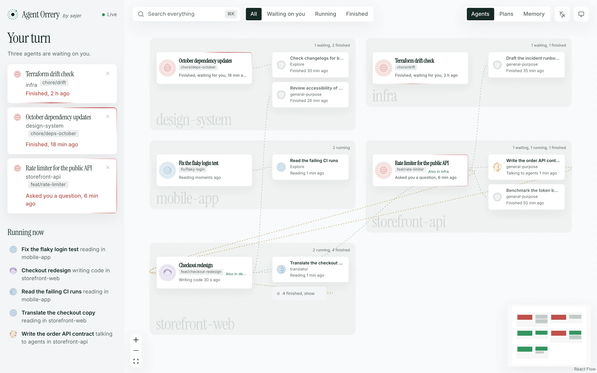

<h1 align="center">agent-graph</h1>

<p align="center">
  <strong>A live map of your Claude Code agents, and what's waiting on you.</strong><br>
  See every session and subagent, the repo each one is working in, who started whom, and which sessions need your reply.
</p>

<p align="center">
  <a href="https://github.com/Luis-Sejer/agent-graph/actions/workflows/ci.yml"></a>
  <a href="LICENSE"></a>
  
  
  
</p>

<p align="center">
  
  <br>
  <sub>Demo data. Run <code>pnpm demo</code> to explore it yourself.</sub>
</p>

## Why

Run a few Claude Code sessions with subagents and it gets hard to keep track. Which one asked you a question an hour ago? Which agent is editing the web app for a session you started in the API? Did that subagent finish?

agent-graph answers that at a glance. It reads the transcripts Claude Code already writes, so there's nothing to set up in Claude: no hooks, no plugins, no MCP servers.

## Features

- **Your turn.** Every session that finished or asked you something, oldest first, with how long it has waited. The tab title shows the count. Dismiss one until it does something new.
- **Rooms per repository.** Each agent sits in the repo its work touches, not the folder its session started in. A session started in the API whose subagents edit the web app reaches across into the web app's room.
- **Live state.** Each agent's orb shows what it's doing now: reading, writing code, running a command, talking to other agents, or waiting on you. Messages between agents travel along the lines as they're sent.
- **Focus.** Click an agent to light up its parent, its subagents and everyone it messaged, and dim the rest. A drawer shows what it has done, step by step, and a command to resume the session.
- **Plans and memory.** Read the plans and memory notes Claude has saved, by project, with search.
- **Quiet by design.** It only reads files, never writes them, and nothing leaves your machine.

<table>
  <tr>
    <td width="50%"></td>
    <td width="50%"></td>
  </tr>
  <tr>
    <td><sub>Click an agent to see everything connected to it.</sub></td>
    <td><sub>Plans, linked to the sessions that wrote them.</sub></td>
  </tr>
</table>

## Get started

### Let your agent install it

Ask Claude Code, or any coding agent:

> Install agent-graph for me: clone https://github.com/Luis-Sejer/agent-graph and follow its INSTALL.md.

[`INSTALL.md`](INSTALL.md) walks the agent through checking Docker, writing settings for your machine, starting the container and checking it works.

### With Docker

```bash
git clone https://github.com/Luis-Sejer/agent-graph.git
cd agent-graph
printf 'AGENT_GRAPH_UID=%s\nAGENT_GRAPH_GID=%s\n' "$(id -u)" "$(id -g)" > .env
docker compose up -d --build
```

Open http://127.0.0.1:4777. The container comes back after a crash and whenever Docker starts. To have it after a reboot, turn on **Start Docker Desktop when you sign in** in Docker Desktop's settings.

### From source

Needs Node 22 and pnpm (`corepack enable`).

```bash
pnpm install
pnpm build
pnpm start        # http://127.0.0.1:4777
```

### Just looking

```bash
pnpm install
pnpm demo         # made-up sessions on http://127.0.0.1:4780
```

## Settings

Set these in your shell, or in a `.env` file next to `compose.yaml`.

| Variable | Default | What it does |
|---|---|---|
| `AGENT_GRAPH_CODE_DIR` | `~/Documents/GitHub` | Folder holding your repositories, shared read-only with the container so it can tell which repo an agent works in (Docker only) |
| `AGENT_GRAPH_UID` / `AGENT_GRAPH_GID` | `501` / `20` | Your user and group id; Claude Code's files are readable only by you (Docker only) |
| `AGENT_GRAPH_PORT` | `4777` | Port on this machine |
| `AGENT_GRAPH_WINDOW_HOURS` | `6` | How far back to show sessions and agents |
| `AGENT_GRAPH_WAITING_HOURS` | `24` | How long a session waiting on you stays listed |
| `AGENT_GRAPH_CLAUDE_DIR` | `~/.claude` | Where Claude Code keeps its files (from source only) |

## How it works

Claude Code saves every session to `~/.claude/projects/<project>/<session>.jsonl`, and each subagent to a file beside it. agent-graph reads the new lines every second and builds a graph:

- **Sessions and subagents** come from those files and their metadata.
- **Rooms** come from the file paths each agent's tools touch. agent-graph walks up from each path to the nearest git repository, and counts a worktree as its main repository.
- **Waiting on you** means the session's last reply ended its turn, or it asked a question you haven't answered.
- **Messages** come from agents' `SendMessage` calls and the replies they receive.

The page is React with [React Flow](https://reactflow.dev) and [Thinking Orbs](https://libraries.dev/orbs). The server is plain Node with no dependencies.

## Privacy and security

Your transcripts hold your code, your prompts and sometimes secrets, so agent-graph is built to keep them in:

- **The graph holds no content.** Only titles, repo and branch names, agent types, tool names, file names and times reach the page. Never messages, commands or tool output.
- **It only listens on this machine.** The server binds to `127.0.0.1`, and Docker publishes it there only.
- **Other websites can't read it.** Requests for another hostname are refused, which blocks DNS rebinding. So are data requests from other sites.
- **Read-only.** It never writes to your files, and the server accepts only `GET` requests. Plans and notes are opened by name from the server's own folder listing, never by a path from the request.
- **No scripts from content.** Plans and notes render as Markdown without raw HTML or images, under a strict Content Security Policy.
- **A small supply chain.** The server has no dependencies. Front-end packages are pinned and only installed once they're a week old, and the Docker images are pinned by digest. The container runs as you, with a read-only filesystem and no Linux capabilities.

Found a problem? See [SECURITY.md](SECURITY.md).

## FAQ

**Does it work with several machines?** No. It reads the Claude Code files on the machine it runs on.

**Does it slow Claude Code down?** No. It reads files Claude Code writes anyway, and adds no hooks.

**Why is an agent in the wrong room?** The room is the repository its tools touched most. An agent that only ran shell commands, without paths, stays with its session. In Docker, repositories outside `AGENT_GRAPH_CODE_DIR` can't be seen.

**Does it work on Linux?** Yes. Set `AGENT_GRAPH_UID`, `AGENT_GRAPH_GID` and `AGENT_GRAPH_CODE_DIR` to match your machine.

## Contributing

Bug reports, ideas and pull requests are welcome. See [CONTRIBUTING.md](CONTRIBUTING.md), and [AGENTS.md](AGENTS.md) if an agent is doing the work.

## Licence

[MIT](LICENSE). Not affiliated with Anthropic.
